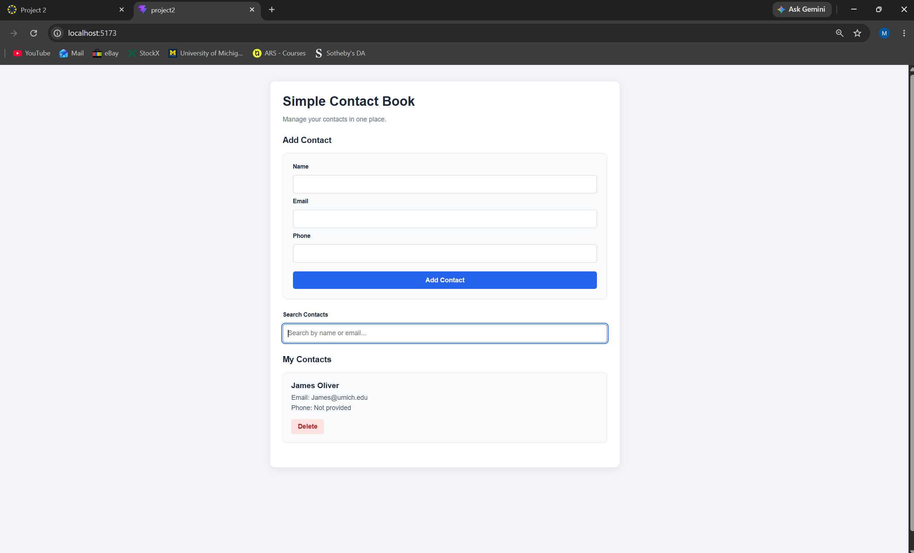
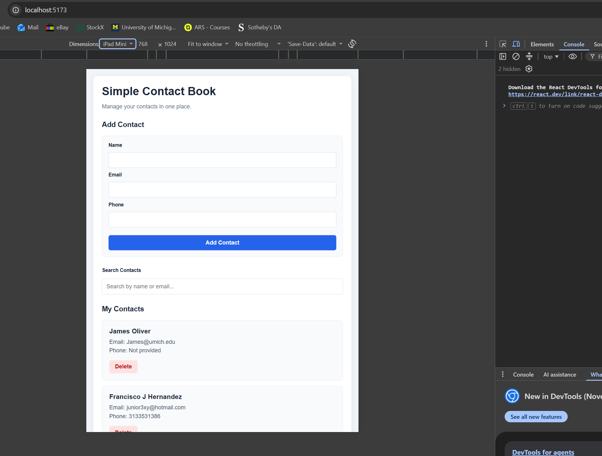
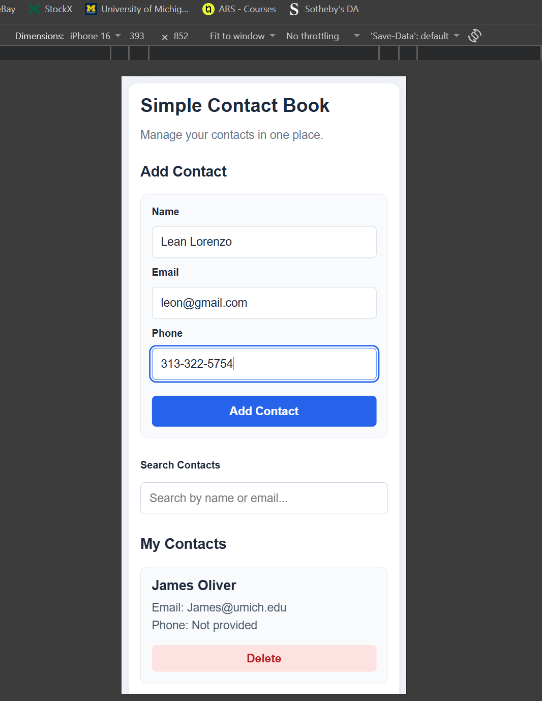

Simple Contact Book — CIS 435 Project 2

Description
A simple React application that allows users to manage their contacts. Users can add, view, search, and delete contacts.

Features
Add contacts with name, email, and optional phone number
View all saved contacts
Search contacts by name or email
Delete individual contacts
Form validation for required fields and email format
Responsive layout for desktop, tablet, and mobile

Technologies Used
React
JavaScript
Vite
HTML/CSS

Running the Project
Open a terminal inside the Project2 folder.
Run npm install.
Run npm run dev.
Open the local URL displayed in the terminal.

Screenshots

Desktop

Tablet

Mobile
